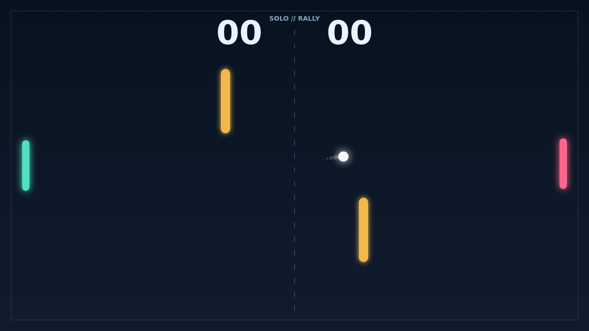

# Carom

Carom begins with a clean serve and a field split by a quiet center net. Move
your paddle into the rally, read the angle off the opponent's return, and chase
the first point in a fast opening exchange.

Every paddle hit has a little character. Slide through the ball while moving to
add spin, then watch the flight curl after it leaves the face. The two gold
banks turn a safe return into a puzzle: a shot that looks wide can rebound into
the open side.

As the score climbs toward match point, rallies become a test of nerve and
positioning. Hold the lead by two to close the duel, or keep fighting through
deuce until a bank shot and a well-timed paddle movement finally break the tie.

